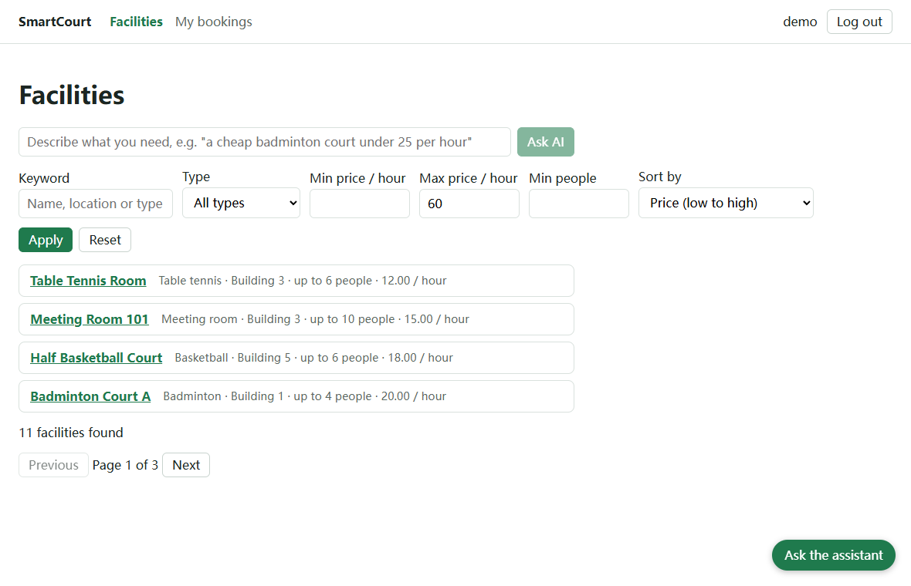
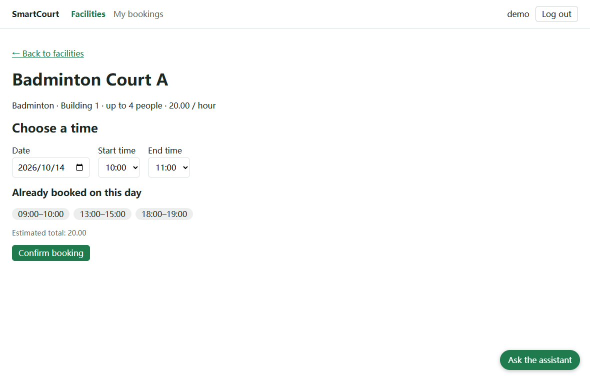
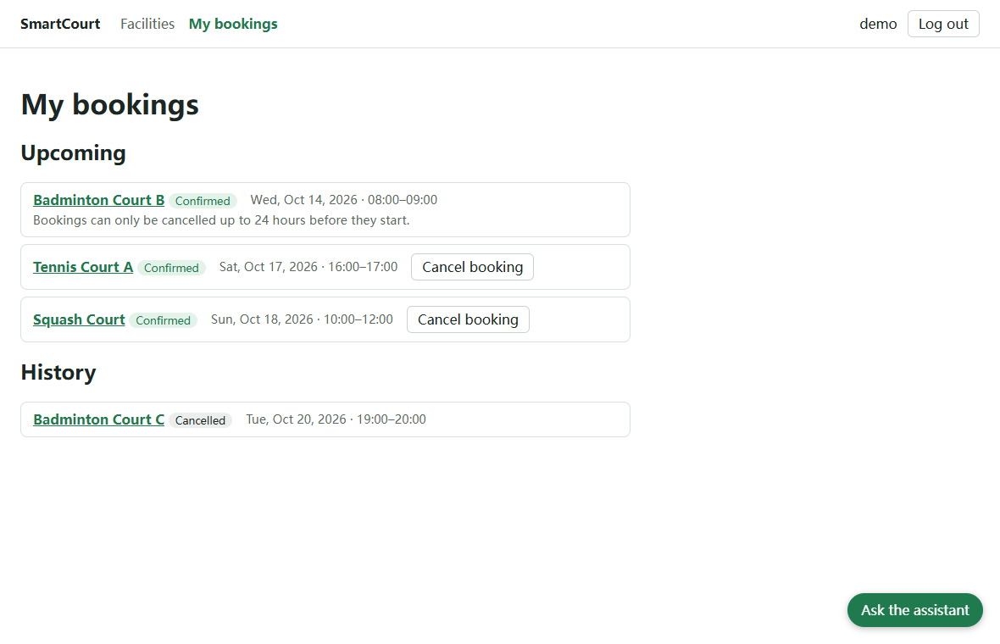
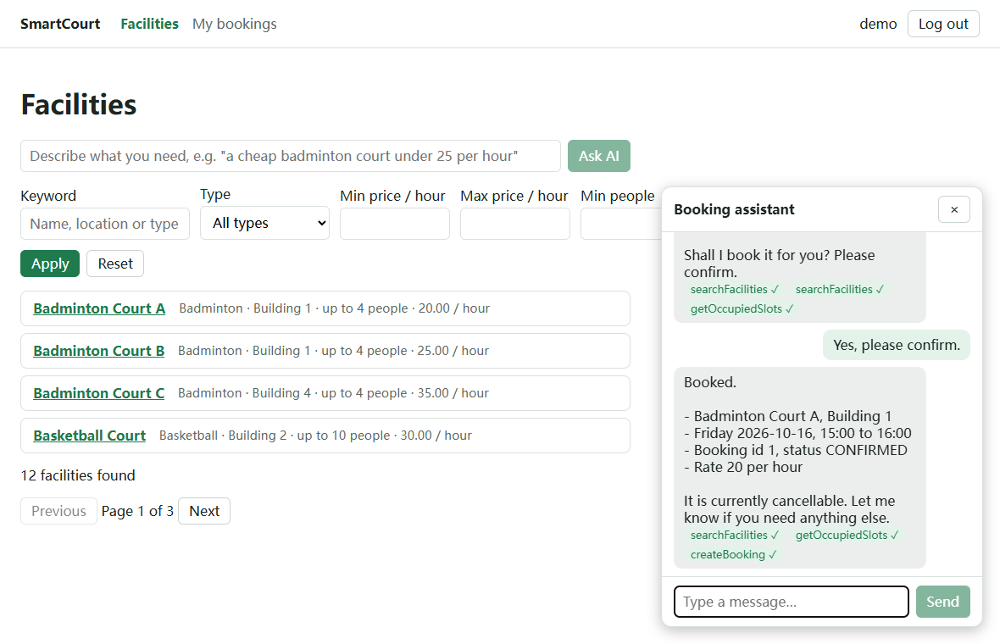

# SmartCourt

A full-stack booking system for shared facilities such as sports courts and meeting rooms. Users search
facilities, pick a time range and book it; the system guarantees that one time slot can never be booked
twice, even when two requests arrive at the same moment. An AI layer adds a natural-language facility
search and a booking assistant that can search, book and cancel on behalf of the signed-in user.

- **Backend:** Java 17, Spring Boot 3.5, Spring Security (JWT), Spring Data JPA, Spring AI
- **Frontend:** React 19, TypeScript (strict), Vite 7, TanStack Query, react-hook-form + zod
- **Tests:** 45 backend tests (JUnit 5, MockMvc) and 35 frontend unit tests (Vitest)

| Facilities: filters, sorting, AI search | Booking: choose a time range |
|---|---|
|  |  |

| My bookings: upcoming, history, cancel | Booking assistant: a real conversation |
|---|---|
|  |  |

> The booking-assistant screenshot is a real conversation with DeepSeek `deepseek-flash`, taken in the web
> interface on 2026-10-15: the model checked the free slots, asked for confirmation and then booked. The other
> screenshots contain no model output.

## What it does

| Area | Details |
|---|---|
| Accounts | Register, log in, JWT sessions that survive a reload, automatic log-out when the token expires |
| Facility search | Keyword, type, price range, minimum capacity, sorting and paging; the whole search lives in the URL, so reload, back/forward and shared links keep it |
| Booking | Pick a day and an hour range, see the ranges already taken, instant validation, and a clear message plus a refresh when somebody else takes the slot first (409) |
| My bookings | Upcoming and history, two-step cancellation, and a clear reason when the 24-hour notice no longer allows cancelling |
| AI search | Describe what you need in one sentence; the model only returns filters, which go through the same validation and the same paged query as a typed search |
| Booking assistant | A chat panel whose model can search facilities, check free times, book and cancel through function calling; every tool call is shown as a badge |

## Design decisions worth reading

- **No double booking.** Creating a booking locks the facility row (pessimistic write lock) and checks for an
  overlapping confirmed booking in the same transaction, so two simultaneous requests cannot both succeed.
  Time ranges are half-open, so back-to-back bookings are allowed. A test starts eight threads that book the
  same slot and asserts that exactly one succeeds and seven get `409`.
- **The model never decides who you are.** The user id comes from the authenticated request and is injected
  into the tools on the server; it is not a tool parameter the model can fill in.
- **The model asks before it acts.** The assistant must state exactly what it is about to book or cancel and
  wait for a clear confirmation before calling the tool.
- **The model returns data, not queries.** AI search produces a small filter object that is validated and
  executed by the existing search code; the model cannot run anything else.

## Quick start

Requires JDK 17, Maven and Node.js 20+. No database and no Docker: data lives in an in-memory H2 database,
twelve demo facilities are inserted on startup, and everything resets when the backend restarts.

```bash
# terminal 1 - backend on http://localhost:8080
cd backend
mvn spring-boot:run

# terminal 2 - frontend on http://localhost:5173 (proxies /api to the backend)
cd frontend
npm install
npm run dev
```

Open <http://localhost:5173> and register an account on the login page (no demo user is seeded).

### Turning the AI on

The application works without a key; the AI search box and the assistant then say that AI is not configured.
Any OpenAI-compatible provider works. Set these environment variables **before** starting the backend:

```bash
LLM_API_KEY=your-key                   # required; never commit it
LLM_BASE_URL=https://api.deepseek.com  # optional, this is the default
LLM_MODEL=deepseek-flash               # optional, this is the default
```

## Quality

| Check | Command | Result |
|---|---|---|
| Backend tests | `cd backend && mvn test` | 45 tests |
| Frontend tests | `cd frontend && npm test` | 35 tests |
| Lint and type-check | `cd frontend && npm run lint && npm run build` | clean |
| Backend coverage (JaCoCo 0.8.13, measured 2026-10-14) | `mvn org.jacoco:jacoco-maven-plugin:0.8.13:prepare-agent test org.jacoco:jacoco-maven-plugin:0.8.13:report` | 92.6 % of lines, 79.0 % of branches |

The coverage report is written to `backend/target/site/jacoco/index.html`.

The automated AI tests run the real Spring AI client and tool-calling loop against a scripted fake model
server, so they need no network and no key; they prove the plumbing, the identity rules and the validation, not
the behaviour of a real model. The AI features were additionally tried against DeepSeek `deepseek-flash`
through the HTTP API on 2026-10-14 (search, availability check, confirmation, booking) and through the web
interface on 2026-10-15. That was a handful of requests, not a systematic evaluation; it did show two prompt
problems the scripted model could not reveal (a currency symbol the system does not have, and Markdown
symbols the chat window does not render), both fixed in the system prompt.

## Documentation

| Document | What it covers |
|---|---|
| [Backend README](backend/README.md) | Tech stack, configuration, the full API table, AI response shapes, tests |
| [Frontend README](frontend/README.md) | Features, scripts, project structure, tests |

## Project layout

```
backend/    Spring Boot API (Java 17, Maven)
frontend/   React + TypeScript single-page app (Vite)
```

## Known limitations

- Data is in memory and is reset on every restart; there is no PostgreSQL profile yet.
- There is no admin role: every signed-in user has the same permissions.
- A JWT cannot be revoked before it expires, and the session token is kept in `localStorage`.
- Times are local date-times without a time zone, and the opening hours (08:00 to 22:00) are a frontend constant.
- No end-to-end or component tests, no CI pipeline and no Docker setup yet.
- AI behaviour was checked with a handful of real requests (API and web interface), not with a systematic evaluation.
