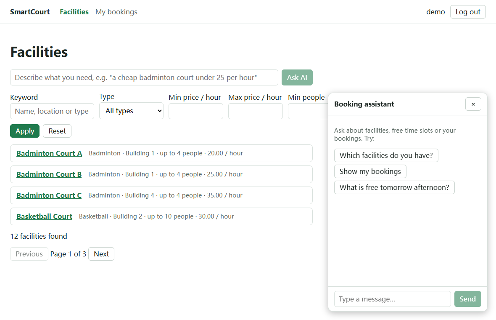

# SmartCourt Frontend

Single-page app for booking shared facilities such as sports courts and meeting rooms. Browse and filter
facilities, pick a time range, book it, manage your bookings, and let an AI assistant search and book for
you. It talks to the [SmartCourt backend](../backend/README.md) (Spring Boot) through a REST API.

| Facilities: filters, sorting, AI search | Booking: choose a time range |
|---|---|
|  |  |

| My bookings: upcoming, history, cancel | Booking assistant |
|---|---|
|  |  |

## Features

- **Accounts**: register, log in, session kept across reloads, automatic logout when the token expires.
- **Facility search**: keyword, type, price range, minimum capacity and sort order; paging; everything lives
  in the URL, so reload, back/forward and shared links keep the search.
- **Booking**: choose a day and an hour range, see the ranges already taken, get instant feedback, and a
  friendly message plus a refresh when somebody else takes the slot first (409).
- **My bookings**: upcoming and history, two-step cancellation, and a clear reason when the 24-hour
  notice no longer allows cancelling.
- **AI search**: describe what you need in a sentence; the model only returns filters, which go through
  the same validation and the same paged query as a typed search.
- **Booking assistant**: a chat panel that can search facilities, check free times, book and cancel for
  the signed-in user. Tool calls are shown as badges.

## Tech stack

React 19, TypeScript (strict), Vite 7, React Router 7, TanStack Query 5, react-hook-form + zod 4,
Vitest, ESLint 10. Plain CSS, no UI framework, no global store.

## Run it

Prerequisites: Node.js 20+ and the backend running on <http://localhost:8080>
(`mvn spring-boot:run` in `../backend`).

```bash
npm install
npm run dev        # http://localhost:5173, /api is proxied to http://localhost:8080
```

| Script | Purpose |
|---|---|
| `npm run dev` | Dev server with hot reload and the `/api` proxy (`vite.config.ts`) |
| `npm test` | Unit tests (Vitest) |
| `npm run lint` | ESLint |
| `npm run build` | Type-check (`tsc -b`) and production bundle in `dist/` |
| `npm run preview` | Serve the production bundle locally |

The AI features need an API key on the **backend** (`LLM_API_KEY`). Without it the app works normally and
the AI search box and the assistant show the server's "AI is not configured" message.

## Project structure

```
src/
  api/          fetch client and one module per backend resource (typed)
  auth/         session storage, AuthProvider, route guard
  components/   Layout, ChatWidget, AiSearchBox
  lib/          pure functions with unit tests: dates, booking rules, cancellation, filters, errors
  pages/        one component per route
```

## Testing

`npm test` runs 35 unit tests on the pure functions in `src/lib`: the half-open overlap rule (back-to-back
ranges are allowed), validation messages, the 24-hour cancellation boundary, URL filter parsing and
sanitising, and date handling that must not shift across time zones. Run them under another zone to see
the point of the date tests:

```bash
TZ=Asia/Shanghai npm test      # Windows cmd: set TZ=Asia/Shanghai, then npm test
```

## Known limitations

- The session token lives in `localStorage` (simple, XSS-exposed) and there is no refresh token.
- Opening hours (08:00 to 22:00) are a frontend constant; the backend has no schedule per facility.
- The venue's time zone is assumed to equal the browser's.
- No component or end-to-end tests yet.
